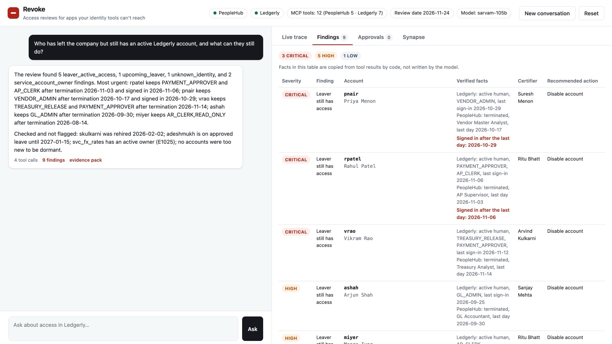
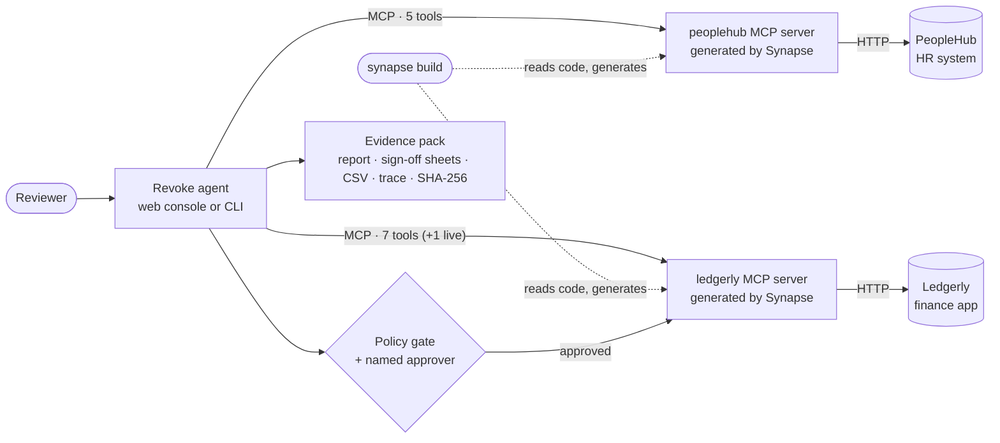

# Revoke

[](https://github.com/2ndbrainlabs-ai/synapse-cli-ts)
[](https://modelcontextprotocol.io/)
[](https://github.com/vaibhavdes/vibeathon-revoke/actions/workflows/tests.yml)
[](LICENSE)

**Access reviews for the apps your identity tools can't reach.**

Revoke checks who can do what in an in-house finance app against the HR system, finds the people who left or
changed jobs but kept their access, and fixes it after a named person approves. Neither app is changed:
[Synapse](https://github.com/2ndbrainlabs-ai/synapse-cli-ts) turns each one's existing code into an MCP server, and
the agent works only through those tools.

2nd Brain Labs × Geek Room Vibe-a-thon · **Track 3: A copilot that works across two systems**

**Video:** [youtu.be/JQCk0AJ4F1U](https://youtu.be/JQCk0AJ4F1U) (3½ min, every question answered live)



## The problem

Every audited company has to prove, again and again, that people who left or changed jobs can no longer do things
they shouldn't. It is the user access review, required by SOX, SOC 2, ISO 27001 and HIPAA.

- **It keeps failing.** 79% of former employees say at least one work account still worked after they left [1].
- **The tools don't reach the apps that matter.** Identity-governance tools review only the apps they have a
  connector for. About 30% of enterprise apps have none, and 52% of enterprises report a breach caused by the
  manual identity work these apps need [2]. The in-house finance app, the old ERP module and the admin panel are
  still reviewed by exporting users, matching them against HR in a spreadsheet and emailing managers. That takes
  weeks, and leavers keep their access in the meantime.
- **In India it is becoming law.** The DPDP Rules 2025 require measures to control access to systems holding personal
  data (Rule 6(1)(b)); failing to keep reasonable security safeguards carries a penalty of up to ₹250 crore, from May
  2027 [3]. SEBI's cybersecurity framework requires regulated firms to review user access periodically [4], and RBI's
  IT governance directions have an access-control chapter for banks and NBFCs [5]. Mid-size firms run Tally, Zoho,
  custom ERPs and home-grown HR tools, which no connector covers.

The missing piece is the connector, and building one for a legacy app is a project measured in months.

## What it does

1. **Connects both systems without touching them.** `synapse build` reads each system's code and generates an MCP
   server, exposing only the endpoints a review needs. Salary data, account deletion and payment approval are
   withheld.
2. **Answers questions that need both systems.** Ask in plain English; the agent reads every active account, joins
   them to HR in one call (matching past emails too) and checks each one against the rules.
3. **Shows facts, not model prose.** Every finding carries facts copied from the tool results by code: roles and last
   sign-in from Ledgerly, status and last day from PeopleHub. Severity follows policy; the certifier is the manager
   in HR.
4. **Picks up new endpoints instantly.** When Ledgerly ships a new endpoint, `synapse build --discover` adds it as a
   tool (12 → 13) and the next question uses it, with no restart.
5. **Fixes only with approval.** The agent can only file change requests. Policy in code refuses unsafe ones, a named
   person approves the rest, the Synapse write tool runs, and every account is read back to confirm.
6. **Leaves evidence for the auditor.** Each question writes a report, a sign-off sheet per manager, the findings as
   CSV, every tool call, every approval, and a SHA-256 manifest.

## Track 3 coverage

| Track 3 asks for | Revoke |
|---|---|
| Two separate codebases turned into MCP servers with Synapse | [`systems/peoplehub`](systems/peoplehub) (HR, 5 tools) and [`systems/ledgerly`](systems/ledgerly) (finance, 7 tools). Generated servers are committed unedited; built by [`scripts/build_mcp.py`](scripts/build_mcp.py) |
| An agent that uses both | [`agent/revoke.py`](agent/revoke.py), from the web console or the command line |
| At least two questions that need both systems | Five, plus "fix it" (below). Each joins Ledgerly accounts to PeopleHub records by email |
| Live update: new endpoint, `synapse build --discover`, agent uses it | [`scripts/live_update.py`](scripts/live_update.py) or one button in the console. The answer changes from "stale access" to "account used after leaving: approved USD 48,200" |
| Answers combine both systems correctly | The join is done in code. [`eval/scripted_check.py`](eval/scripted_check.py) reaches every planted case through the MCP tools with no model (13/13); [`eval/agent_eval.py`](eval/agent_eval.py) scores real model runs against an answer key computed from the raw data |

## How it works



A question goes through these steps:

1. The agent gets **read tools only**, from a fresh MCP session per question (so a rebuilt server is picked up).
2. It lists Ledgerly's active accounts and sends every email to PeopleHub's lookup in **one call**; code builds the
   joined view.
3. The model decides which accounts are findings and why. Code then **checks each finding against the data** and
   rejects claims no tool result supports. Movers and role conflicts are computed in code, and a completeness check
   asks about any account matching a rule that the model skipped.
4. To change anything the model calls `propose_changes`. [`agent/policy.py`](agent/policy.py) refuses changes to
   service accounts, to accounts that aren't active, without a reason, or for a role the account doesn't hold; a
   person approves the rest by name; code calls `disable_account` or `revoke_role` with exactly the approved
   arguments and reads the account back.

| Folder | Contents |
|---|---|
| [`systems/`](systems) | PeopleHub and Ledgerly (FastAPI), their seed data and their Synapse-generated MCP servers |
| [`mcp/exposure.json`](mcp/exposure.json) | Which endpoints become tools, which are withheld, and why |
| [`agent/`](agent) | MCP hub, model client with provider fallback, policy gate, grounding, evidence pack, CLI |
| [`web/`](web) | The console: conversation, live trace, findings, approvals, Synapse tab |
| [`eval/`](eval) | Answer key, no-model check, model eval |
| [`tests/`](tests) | 34 offline tests, including the agent loop driven by a scripted model |
| [`scripts/`](scripts) | Seed data, Synapse build, start everything, live update, reset |
| [`evidence/samples/`](evidence/samples) | Real runs, replayable in the console without a model |

## What it finds

The seed data is a fictional company with 89 employees and 47 Ledgerly accounts, with the cases real reviews get
wrong planted in it ([details](docs/DATA.md)).

| Question | What the agent finds |
|---|---|
| Who has left but still has access? | 5 leavers, two with payment or treasury rights. Priya is found only through her **maiden-name** email. A rehire and someone on approved leave are correctly left alone |
| Who changed jobs but kept old privileges? | AP → Sales who can still approve payments; Treasury → HR who can still release funds; GL → Procurement who can still post journals. A promotion is fine |
| Whose roles conflict? | 4 segregation-of-duties conflicts, each routed to the manager in HR who must sign off |
| Which accounts are dormant or shared? | 3 accounts unused for 90 days or never used, and a shared `finance-ops@` login nobody is accountable for |
| Was any leaver's account used after their last day? *(after the live update)* | **Rahul left on 3 Nov; on 6 Nov his account approved USD 48,200** to a vendor whose bank details changed the day before |
| Fix it | Disable each leaver and remove each old-job role, after approval. Service accounts are never disabled; the contractor with no HR record and anyone serving notice are escalated, not disabled |

## Results

Scored against an answer key computed from the raw data ([`eval/expected.py`](eval/expected.py)), 3 runs per
question on Sarvam's `sarvam-105b`:

| Question | Expected findings found | Recorded findings correct | False flags |
|---|---|---|---|
| Leavers | 15/15 | 27/27 | 0 |
| Movers | 12/12 | 12/12 | 0 |
| Role conflicts | 12/12 | 12/12 | 0 |
| Dormant and shared | 12/12 | 12/12 | 0 |
| Used after leaving | 6/6 | 32/32 | 0 |
| Fix it | 27/27 changes queued, none wrong | 63/63 | 0 |

A question takes 21–36 s. Earlier misses (a skipped mover, invented role conflicts, a missed leaver) are why movers,
conflicts and the completeness check now run in code.

## How Revoke differs

The problem is real and funded: the access-review market is about USD 4.7 billion in 2026 [6]. What is new is how
the in-house app is reached.

| Approach | How it reaches an in-house app |
|---|---|
| Governance suites (SailPoint, Saviynt, Veza, Microsoft Entra) | Ready-made connectors; otherwise a CSV upload or a manual task [7] |
| Disconnected-app automation (Cerby) | Automates the app's own screens [8] |
| AI access tools (Opal, Offroad) | Agents over identity data that connectors already collected [9] |
| **Revoke** | **Synapse generates the connector from the app's own code, in minutes** |

## Run it

**With Docker** (no install, no key needed to look around):

```bash
docker build -t revoke .
docker run -p 7860:7860 revoke                       # http://localhost:7860, past runs replay
docker run -p 7860:7860 -e GROQ_API_KEY=... revoke   # ask your own questions
```

**From source** (Python 3.12+, Node.js 20+):

```bash
git clone https://github.com/vaibhavdes/vibeathon-revoke.git && cd vibeathon-revoke
python3 -m venv .venv && source .venv/bin/activate
pip install -r requirements.txt
npm install                     # the Synapse CLI
cp .env.example .env            # add a free Groq key
python -m scripts.start         # both systems + console at http://127.0.0.1:8700
```

**Try it:** click a question → watch the live trace → open Findings → Synapse tab → **Ship endpoint + rebuild** →
ask "Did any leaver's account do anything after their last day?" → ask "Fix it" → approve under Approvals → open
the evidence pack. **Reset** puts the data back.

**Without the console:**

```bash
python -m scripts.build_mcp                 # regenerate both MCP servers with Synapse
python -m eval.scripted_check               # every planted case through the MCP tools, no model
pytest -q                                   # 34 offline tests
python -m agent.revoke "Who has left but still has an active Ledgerly account?"
```

The two MCP servers also work in Claude Desktop, Cursor or any MCP client: see [MCP setup](docs/MCP_SETUP.md). To
review another app, see [Adding an app](docs/ADDING_AN_APP.md).

**Configuration** (`.env`)

| Variable | Purpose |
|---|---|
| `GROQ_API_KEY` | Free [Groq](https://console.groq.com/keys) key; enough on its own. `GROQ_API_KEY_2` adds a second account's quota |
| `SARVAM_API_KEY` | Optional [Sarvam](https://dashboard.sarvam.ai) Token Factory key, used when Groq is at its limit |
| `CEREBRAS_API_KEY`, `GEMINI_API_KEY` | Optional free fallbacks |
| `LLM_PROVIDERS` | Order to try providers (default `groq,sarvam,cerebras,gemini`) |
| `MAX_WAIT_SECONDS` | Longest wait for a per-minute limit; past it, Revoke says when the model is back instead of waiting |
| `REVIEW_DATE` | The date the review runs on, pinned so the data always tells the same story |

## Limits

- The company and its data are invented and small; the cases are modelled on common access-review findings
  ([how close to real data](docs/DATA.md#how-close-is-this-to-real-data)).
- Revoke recommends and executes approved changes; it does not replace the auditor's judgment or certify compliance.
- Like many internal apps, Ledgerly's API has no authentication. In production, pass a service credential through
  Synapse's `${ENV}` header placeholders.
- On free-tier models a question can take 1–4 minutes because of per-minute token limits.

## Built with

[Synapse CLI](https://github.com/2ndbrainlabs-ai/synapse-cli-ts) · [Model Context Protocol](https://modelcontextprotocol.io/) ·
[FastAPI](https://fastapi.tiangolo.com/) · [Groq](https://groq.com/) and [Sarvam](https://www.sarvam.ai/) models
through an OpenAI-compatible client · [Docker](https://www.docker.com/) · [GitHub Actions](https://github.com/features/actions)

## Sources

1. TechTarget, *When employees leave, their AI access may not* (Sagiss survey of 1,000 former employees, 2026):
   [techtarget.com](https://www.techtarget.com/news/when-employees-leave-their-ai-access-may-not/874659/)
2. Ponemon Institute research via Cerby: [cerby.com](https://www.cerby.com/blog/new-ponemon-institute-research);
   Cloud Security Alliance: [cloudsecurityalliance.org](https://cloudsecurityalliance.org/blog/2025/08/13/why-you-should-say-goodbye-to-manual-identity-processes)
3. Digital Personal Data Protection Rules 2025: [PIB (PDF)](https://static.pib.gov.in/WriteReadData/specificdocs/documents/2025/nov/doc20251117695301.pdf);
   Rule 6: [dpdpa.com](https://dpdpa.com/dpdparules/rule6.html)
4. SEBI Cybersecurity and Cyber Resilience Framework (CSCRF), summary by Deloitte:
   [deloitte.com (PDF)](https://www2.deloitte.com/content/dam/Deloitte/in/Documents/risk/in-ra-cscrf-for-sebi-regulated-entities-deloitte-india-20.09-noexp.pdf)
5. RBI Master Direction on IT Governance, Risk, Controls and Assurance Practices, 2023:
   [rbi.org.in](https://www.rbi.org.in/Scripts/BS_ViewMasDirections.aspx?id=12562)
6. Mordor Intelligence, *Access certification and review market*:
   [mordorintelligence.com](https://www.mordorintelligence.com/industry-reports/access-certification-and-review-market)
7. Veza, *Access governance for disconnected apps*: [veza.com](https://veza.com/blog/access-governance-for-disconnected-apps/)
8. Cerby, *Automate the apps your identity stack can't reach*:
   [cerby.com](https://www.cerby.com/blog/automate-management-of-the-apps-your-identity-stack-cant-reach)
9. SecurityWeek on [Opal](https://www.securityweek.com/opal-security-raises-23-million-for-ai-native-identity-governance/)
   and [Offroad](https://www.securityweek.com/offroad-emerges-from-stealth-with-7-million-to-tackle-enterprise-identity-risk/)

## License

[MIT](LICENSE). The people, emails and payments in this repository are invented.
